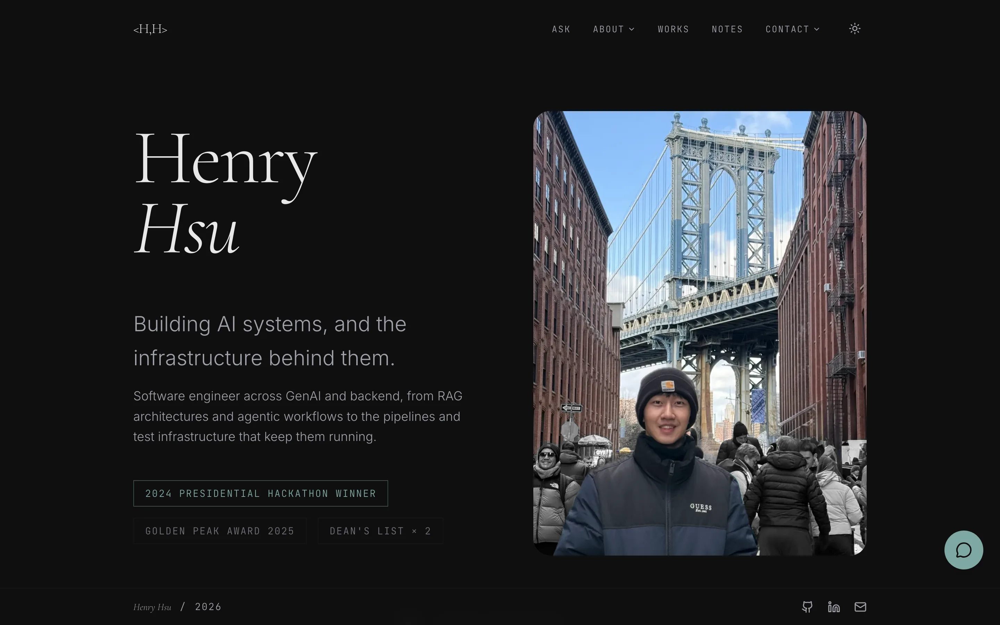

# Personal Website Back-End

[](https://github.com/yarikama/personal-website-back-end/actions/workflows/ci.yaml)
[](https://api.yarikama.com/docs)
[](https://codecov.io/gh/yarikama/personal-website-back-end)
[](pyproject.toml)
[](https://github.com/astral-sh/ruff)
[](https://github.com/astral-sh/uv)
[](https://microsoft.github.io/pyright/)
[](https://github.com/yarikama/personal-website-back-end/commits/main)

The API behind [yarikama.com](https://www.yarikama.com), Henry Hsu's personal website. It serves the projects and notes, answers visitors' questions about them with a self-hosted language model, and gives the author an editor with inline autocomplete from a second model.

It is built with FastAPI and PostgreSQL. It runs on a single-node k3s cluster on a home server, together with its database, Redis, both models and the monitoring stack, and is reached through a Cloudflare Tunnel. The front end is [personal-website-front-end](https://github.com/yarikama/personal-website-front-end).

[](https://www.yarikama.com)

## What it does

- **Content API**: projects, notes, categories and the Learnings page's knowledge graph, cached at the edge, plus a contact form that emails the owner.
- **Ask about my work**: `POST /api/v1/ask` streams an answer from Qwen3.5-4B over server-sent events, with checked citations to the projects, notes and resume it used.
- **Note autocomplete**: suggestions from Qwen3.5-0.8B-Base while the author writes. Every suggestion and what became of it is stored as training data.
- **Images**: uploads go to Cloudflare R2. A background worker makes WebP variants of each image.
- **Writing with Claude**: an MCP server at `/mcp` lets Claude (Claude Code or claude.ai) draft, edit and publish notes and projects, and build the Learnings graph, signed in as the owner.
- **Protection**: rate limits in Redis, a cap on concurrent answers, a daily limit on questions for the whole site, and an admin area behind Sign in with Google.


## Quick start

Requires [uv](https://docs.astral.sh/uv/) and Docker.

```bash
make install                  # dependencies; also creates .env.local and .env.prod from .env.example
cp .env.example .env          # make run reads .env
docker-compose up -d db redis # local PostgreSQL and Redis
make run                      # API with hot reload on http://localhost:8080 (docs at /docs)
```

More in [Development](docs/development.md).

## Documentation

| Doc | What's in it |
|---|---|
| [Architecture](docs/architecture.md) | Tech stack, project layout, the architecture diagram |
| [Design notes](docs/design.md) | Why the chat reads everything instead of retrieving, autocomplete, rate limits, jobs, caching, observability |
| [Security](docs/security.md) | Sign-in, sessions, uploads, headers |
| [API](docs/api.md) | Endpoints, the ask stream, the writing MCP server, rate limits, image variants, caching |
| [Configuration](docs/configuration.md) | Every environment variable |
| [Development](docs/development.md) | Running locally, env files, testing, migrations, make commands |
| [Deployment](docs/deployment.md) | Merge-to-deploy, rollback, production config, backups |
| [Milestones and roadmap](docs/roadmap.md) | What was built when, and what's next |
