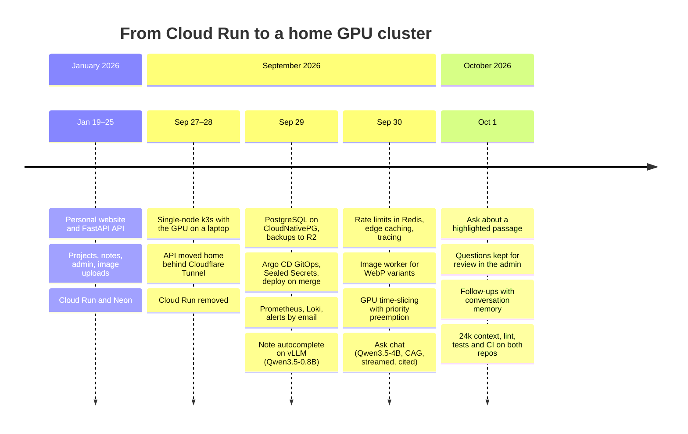

# Milestones and roadmap

## Milestones

Built in January 2026 on Cloud Run and Neon, then moved onto a home server in late September 2026, where it grew a GPU and two self-hosted models.

## Roadmap

Planned, not promised; each item has a reason or a trigger.

- [ ] **Learn from real questions.** Rate answers in the admin's Questions page, and grow the 40-question evaluation set in [`eval/ask/`](../eval/ask/) from them.
- [ ] **Retrieval when the content outgrows the context.** Once the prompt nears its budget (the `AskPromptNearLimit` alert), the next step is a narrow agent with two tools, `search` over PostgreSQL full-text and `read` by document id. The evaluation set decides whether it beats reading everything.
- [ ] **Autocomplete, data and evaluation.** An admin page for suggestions and their outcomes, and offline evaluation against what was actually written.
- [ ] **Autocomplete, fine-tuning.** LoRA on the home GPU as a Kubernetes Job that pre-empts both models, with adapters stored in R2 and served by vLLM.
- [ ] **Autocomplete, reinforcement learning.** DPO from accepted and rejected suggestions, then GRPO with a verifiable reward, and A/B tests of adapters.
- [ ] **A small decision model.** Classify contact messages with a fine-tuned encoder on the CPU, compared with the answer model's structured outputs.
